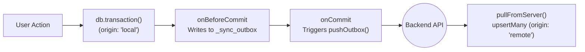

# Reactivity, Multi-Tab Events & Offline Sync

WebDB is built for **local-first and offline-capable web applications**. It gives you reactive live queries and table subscriptions (`db.subscribe()`) that work across browser tabs and Web Workers, along with transactional change-tracking hooks (`onBeforeCommit`, `onCommit`) and conflict-aware upserts (`upsertMany`) to connect your local database to any REST, GraphQL, or WebSocket backend.

> [!TIP]
> **Using React, Vue, Angular, or Plain JS UI bindings?** Check out the [**Reactive Live Queries Guide**](/guides/live-queries-and-frameworks) for zero-bloat framework hooks (`@ahmadmoussawi/webdb/react`, `@ahmadmoussawi/webdb/vue`, `@ahmadmoussawi/webdb/angular`) and chainable `.live()` queries that automatically track accessed tables and `JOIN`s.

---


## 1. Real-Time Table Subscriptions (`db.subscribe`)

Instead of polling the database on a timer or manually wiring event emitters around every mutation, UI components can subscribe directly to table changes with `db.subscribe()`.

```typescript
// Subscribe to one or more tables (or '*' for all tables)
const unsubscribe = db.subscribe(['todos', 'projects'], async (event) => {
  console.log('Modified tables:', event.tables);
  console.log('Origin:', event.origin);      // 'local' | 'remote' | custom
  console.log('From another tab?', event.crossTab); // true if committed in another tab/worker

  // Re-run query to refresh UI state
  const todos = await db.from('todos').orderBy('updated_at', 'desc').toArray();
  renderTodos(todos);
});

// Call unsubscribe() when your component unmounts
// unsubscribe();
```


### How Cross-Tab & Web Worker Reactivity Works


- **Same-Tab Commits (`event.crossTab === false`):** Fires immediately after a mutation or transaction commits on the current `WebDB` instance, and includes `event.changeset` with the exact rows inserted, updated, or deleted.
- **Cross-Tab / Worker Commits (`event.crossTab === true`):** When another open browser tab or background Web Worker commits a change to the same database name, WebDB automatically broadcasts a lightweight notification over `BroadcastChannel`, invalidates any stale cached pages in the receiving tab, and triggers your `db.subscribe()` callbacks in real time.

---


## 2. Tracking Mutations (`Changeset` & `coalesced()`)

Every committed mutation produces a [`Changeset`](./src/types/index.ts#L264-L273) object containing raw row-level [`MutationRecord`](./src/types/index.ts#L255-L262)s (`'insert'`, `'update'`, `'delete'`) and a `.coalesced()` helper:

```typescript
export interface MutationRecord {
  table: string;
  op: "insert" | "update" | "delete";
  pk: DbValue | DbValue[] | Record<string, DbValue>;
  oldRow?: DbRow; // Present on 'update' and 'delete'
  newRow?: DbRow; // Present on 'insert' and 'update'
  changedColumns?: string[]; // Present on 'update' (only columns whose value changed)
}

export interface Changeset {
  txId: number;
  origin: string; // Defaults to 'local'
  meta?: Record<string, any>;
  changeCounter: number;
  schemaVersion: number;
  tables: string[];
  changes: MutationRecord[];
  coalesced(): MutationRecord[];
}
```


### Why Use `changeset.coalesced()`?

Within a single transaction, a user or service might insert a draft record and update it three times, or create a temporary record and delete it before committing. Calling `changeset.coalesced()` folds multiple edits to the same `(table, primaryKey)` into the minimal net change before you send it over the network:

| First Action in Tx | Later Action in Tx | Result from `changeset.coalesced()` |
| :--- | :--- | :--- |
| `insert` | `update` | Single **`insert`** with the final merged `newRow` |
| `insert` | `delete` | **Omitted** (net no-op — nothing needs to be synced!) |
| `update` | `update` | Single **`update`** with original `oldRow`, final `newRow`, and combined `changedColumns` |
| `update` | `delete` | Single **`delete`** with the original `oldRow` |

---


## 3. Commit Lifecycle Hooks: `onBeforeCommit` vs. `onCommit`

WebDB exposes two hooks for integrating with an offline sync queue or audit log:

1. **`db.onBeforeCommit((changeset, tx) => Promise<void> | void)`**
   - Runs **inside** the active transaction right before the commit is finalized.
   - Gives you `tx` so you can write to an `_outbox` table in the **exact same atomic transaction** as the user's change. If the tab crashes, your outbox is guaranteed to stay 100% consistent with your application tables.
2. **`db.onCommit((changeset) => void)`**
   - Runs **after** the transaction is durably committed to disk.
   - Ideal for waking up a background `fetch()` push loop or logging analytics.

---


## 4. Preventing Echo Loops with `origin` & `meta`

Every transaction and write method (`insert`, `update`, `delete`, `upsert`, `upsertMany`) accepts an optional `TransactionOptions` object:

```typescript
export interface TransactionOptions {
  origin?: "local" | "remote" | string; // defaults to 'local'
  meta?: Record<string, any>;
}
```

- Leave `origin` as `'local'` (the default) for user edits so your outbox hook queues them for upload.
- Pass `{ origin: 'remote' }` when applying changes downloaded from your server so your outbox hook ignores them and doesn't re-upload server changes back to the server!

---


## 5. Step-by-Step Blueprint: Bidirectional Offline Sync

Below is a complete, copy-pasteable pattern for syncing a local WebDB database with a remote API:





### Step 1: Create Domain & Sync Outbox Tables

```typescript
import { WebDB } from "@ahmadmoussawi/webdb";

const db = await WebDB.open({ name: "notes_app", storage: "idb" });

// 1. Application table
await db.createTable("notes", [
  { name: "id", type: "UUID", primaryKey: true },
  { name: "title", type: "TEXT", notNull: true },
  { name: "body", type: "TEXT" },
  { name: "updated_at", type: "INT64", notNull: true },
]);

// 2. Outbox queue for pending offline mutations
await db.createTable("_sync_outbox", [
  { name: "seq", type: "INT32", primaryKey: true, autoInc: true },
  { name: "table_name", type: "TEXT", notNull: true },
  { name: "op", type: "TEXT", notNull: true },
  { name: "pk", type: "TEXT", notNull: true },
  { name: "payload", type: "TEXT", notNull: true },
]);
```

### Step 2: Capture Local Changes Atomically (`onBeforeCommit`)

```typescript
db.onBeforeCommit(async (changeset, tx) => {
  // Only queue user-initiated local mutations
  if (changeset.origin !== 'local') return;

  for (const m of changeset.coalesced()) {
    if (m.table.startsWith('_sync_')) continue;

    await tx.insert('_sync_outbox', {
      table_name: m.table,
      op: m.op,
      pk: String(m.pk),
      payload: JSON.stringify({
        newRow: m.newRow,
        changedColumns: m.changedColumns,
      }),
    });
  }
});
```

### Step 3: Push Outbox to Server (`onCommit`)

```typescript
let isPushing = false;

async function pushOutboxToServer() {
  if (isPushing || !navigator.onLine) return;
  isPushing = true;

  try {
    while (true) {
      const batch = await db
        .from('_sync_outbox')
        .orderBy('seq', 'asc')
        .limit(50)
        .toArray();

      if (batch.length === 0) break;

      const res = await fetch('/api/sync/push', {
        method: 'POST',
        headers: { 'Content-Type': 'application/json' },
        body: JSON.stringify({ mutations: batch }),
      });
      if (!res.ok) break;

      // Remove acknowledged items using a custom origin so onBeforeCommit ignores it
      const ackedSeqs = batch.map((r) => r.seq);
      await db
        .from('_sync_outbox')
        .whereIn('seq', ackedSeqs)
        .delete({ origin: 'sync-ack' });
    }
  } finally {
    isPushing = false;
  }
}

db.onCommit((changeset) => {
  if (changeset.origin === 'local') {
    void pushOutboxToServer();
  }
});
```

### Step 4: Pull Remote Changes with Last-Write-Wins (`upsertMany`)

```typescript
async function pullDeltasFromServer(sinceCursor: string) {
  const res = await fetch(`/api/sync/pull?since=${encodeURIComponent(sinceCursor)}`);
  if (!res.ok) return;

  const { upserts, deletedIds } = await res.json();

  await db.transaction(
    async (tx) => {
      if (upserts.length > 0) {
        await tx.upsertMany(
          'notes',
          upserts.map((n: any) => ({ ...n, updated_at: BigInt(n.updated_at) })),
          {
            mode: 'merge',
            // Only overwrite local note if the server version is newer
            where: (existing, incoming) =>
              (incoming.updated_at as bigint) >= (existing.updated_at as bigint),
          },
        );
      }

      if (deletedIds.length > 0) {
        await tx.from('notes').whereIn('id', deletedIds).delete();
      }
    },
    { origin: 'remote' }, // Prevents onBeforeCommit from re-queuing pulled rows
  );
}
```
