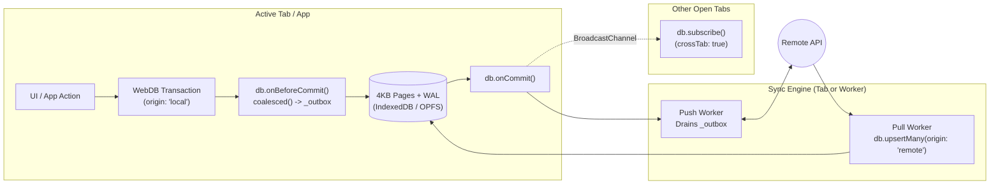

# Building Offline-First Sync Systems with WebDB

WebDB is designed from the ground up for **local-first and offline-capable web applications**. Rather than baking an opinionated network protocol (REST, GraphQL, WebSockets, or CRDTs) into the core engine—which would bloat the `< 100 KB` footprint—WebDB provides **low-level, transactional sync primitives** directly inside the storage and transaction engine.

These primitives solve the hardest parts of building a reliable sync engine:
1. **Atomic Change Capture (`onBeforeCommit`)** — Write to an `_outbox` table inside the exact same WAL transaction as the user's mutation so changes are never lost on tab crash.
2. **Intra-Transaction Coalescing (`changeset.coalesced()`)** — Squash multiple edits within a transaction (`insert + update → insert`, `insert + delete → no-op`, `update + update → merged update`) before queuing network payloads.
3. **Echo-Loop Prevention (`origin` & `meta` tagging)** — Tag remote pull transactions with `{ origin: 'remote' }` so your outbox hook ignores changes that came from the server.
4. **Idempotent Upserts with Last-Write-Wins Guards (`upsert` / `upsertMany`)** — Apply remote batches in a single pass with a custom `where: (existing, incoming) => ...` conflict predicate.
5. **Real-Time Multi-Tab & Worker Reactivity (`subscribe` + `BroadcastChannel`)** — Automatically invalidate stale buffer pool pages and wake up UI components across all open browser tabs when a background worker or sibling tab commits.
6. **Zero-Parse Binary Snapshots (`exportBinary` / `importBinary` / `initialData`)** — Bootstrap new clients from a pre-built `.webdb` binary snapshot in milliseconds instead of replaying thousands of JSON rows.

---

## 1. Architecture Overview



---

## 2. Core Sync & DML Primitives

### 2.1 High-Level DML (`update` & `delete`)

WebDB supports row updates and deletions both directly on the `WebDB` instance (by primary key or filter object) and fluently through `QueryBuilder`:

```typescript
// 1. Update or delete by Primary Key
await db.update('todos', 42, { title: 'Ship Sync Engine', done: 1 });
await db.delete('todos', 42);

// 2. Update or delete by partial filter object
await db.update('todos', { project_id: 10, done: 0 }, { done: 1 });
await db.delete('todos', { done: 1 });

// 3. Fluent QueryBuilder update & delete with arbitrary WHERE clauses
const updatedCount = await db
  .from('todos')
  .where('updated_at', '<', Date.now() - 86_400_000)
  .where('done', '=', 0)
  .update({ status: 'overdue' });

const deletedCount = await db
  .from('todos')
  .whereIn('status', ['archived', 'cancelled'])
  .delete();
```

> [!NOTE]
> **Secondary Index Integrity:** In-place updates that fit within the existing 4 KB data page preserve physical rowids (`(pageId << 16) | cellIdx`) and only update secondary B+Tree indexes whose indexed column values actually changed. When an expanded row overflows its 4 KB page or a row is deleted, WebDB automatically updates the shifted slot pointers for surviving rows on that page.

---

### 2.2 Idempotent `upsert` & `upsertMany` with LWW Guards

When pulling remote changes from a server or handling webhook/WebSocket events out of order, `db.upsert()` and `db.upsertMany()` let you insert new records and resolve conflicts in one atomic operation.

```typescript
export interface UpsertOptions extends TransactionOptions {
  /** Column(s) to check for conflict. Defaults to the table's primary key. */
  conflictTarget?: string | string[];
  /**
   * - 'merge' (default): updates only columns defined in the incoming row
   * - 'replace': overwrites unspecified non-PK columns with null
   * - 'ignore': skips update if a matching row already exists
   */
  mode?: 'merge' | 'replace' | 'ignore';
  /**
   * Conditional conflict predicate (e.g. Last-Write-Wins timestamp/version check).
   * If `where` returns false, the conflicting update is skipped ('ignored').
   */
  where?: (existingRow: DbRow, incomingRow: DbRow) => boolean;
}
```

#### Example: Last-Write-Wins (LWW) Remote Batch Sync

```typescript
const stats = await db.upsertMany('todos', remoteTodosFromApi, {
  origin: 'remote',
  conflictTarget: 'id', // or a unique column like 'client_uuid'
  mode: 'merge',
  where: (existing, incoming) =>
    (incoming.updated_at as bigint) > (existing.updated_at as bigint),
});

console.log(stats);
// { inserted: 12, updated: 4, ignored: 3 }
```

---

### 2.3 Transaction `origin` & `meta` Context

Every transaction and standalone DML method accepts `TransactionOptions`:

```typescript
export interface TransactionOptions {
  origin?: 'local' | 'remote' | string; // defaults to 'local'
  meta?: Record<string, any>;
}
```

- Use `origin: 'local'` (the default) for user-initiated mutations that must be pushed to the remote server.
- Use `origin: 'remote'` when applying server deltas so your outbox hook knows **not** to re-queue those changes for upload.
- Use `meta` to attach correlation IDs, user IDs, or UI source tags (e.g. `{ source: 'drag-drop', batchId: 'sync-99' }`).

---

### 2.4 Transactional Change Capture & Coalescing (`Changeset`)

Every committed mutation produces a `Changeset` containing raw `MutationRecord`s and a `.coalesced()` method:

```typescript
export interface MutationRecord {
  table: string;
  op: 'insert' | 'update' | 'delete';
  pk: DbValue | DbValue[] | Record<string, DbValue>;
  oldRow?: DbRow;          // Present on 'update' and 'delete'
  newRow?: DbRow;          // Present on 'insert' and 'update'
  changedColumns?: string[]; // Present on 'update' (only columns whose value changed)
}

export interface Changeset {
  txId: number;
  origin: string;
  meta?: Record<string, any>;
  changeCounter: number;
  schemaVersion: number;
  tables: string[];
  changes: MutationRecord[];
  coalesced(): MutationRecord[];
}
```

#### How `changeset.coalesced()` Squashes Intra-Transaction Edits

Within a single transaction, a user or service might insert a draft row and update it several times, or create a temporary row and delete it before committing. Calling `changeset.coalesced()` folds mutations per `(table, pk)`:

| First Op in Tx | Subsequent Op in Tx | Coalesced Result |
| :--- | :--- | :--- |
| `insert` | `update` | Single **`insert`** with the latest `newRow` |
| `insert` | `delete` | **Omitted** (net no-op — nothing needs to be synced!) |
| `update` | `update` | Single **`update`** with original `oldRow`, final `newRow`, and union of `changedColumns` |
| `update` | `delete` | Single **`delete`** with the original `oldRow` before the transaction began |
| `delete` | `insert` | Single **`update`** transitioning from `oldRow` to `newRow` |

> [!TIP]
> **Nested Savepoint Rollback:** If a nested savepoint (`await tx.transaction(...)`) throws and rolls back, any mutations performed inside that inner savepoint are automatically discarded from the outer transaction's `Changeset`.

---

### 2.5 Dual Commit Hooks: `onBeforeCommit` vs. `onCommit`

WebDB exposes two distinct lifecycle hooks:

1. **`db.onBeforeCommit((changeset, tx) => Promise<void> | void)`**
   - Runs **inside** the active transaction lease right before the WAL commit frame is flushed.
   - Receives `tx` so you can write to an `_outbox` or audit log table in the **same atomic WAL commit**.
   - If your `onBeforeCommit` callback throws, the entire transaction (both the application data and the outbox writes) rolls back cleanly.
   - Mutations performed inside `onBeforeCommit` do not recursively re-trigger `onBeforeCommit`.
2. **`db.onCommit((changeset) => void)`**
   - Runs **after** the WAL commit is durably flushed.
   - Ideal for waking up a background `fetch` push loop, logging telemetry, or updating external state.

---

### 2.6 Reactive Subscriptions & Real-Time Multi-Tab `BroadcastChannel`

Instead of polling the database on a timer, UI components and workers can subscribe to table changes via `db.subscribe()`:

```typescript
const unsubscribe = db.subscribe(['todos', 'projects'], async (event) => {
  console.log('Changed tables:', event.tables);
  console.log('Origin:', event.origin, 'Cross-tab:', event.crossTab);

  // Re-run query to refresh UI state
  const todos = await db.from('todos').orderBy('updated_at', 'desc').toArray();
  renderTodos(todos);
});
```

- **Local Commits (`event.crossTab === false`):** Fires immediately after a transaction commits on the same `WebDB` instance.
- **Cross-Tab / Worker Commits (`event.crossTab === true`):** When another browser tab or Web Worker commits to the same database name, WebDB broadcasts a lightweight notification over `BroadcastChannel`. Receiving tabs automatically synchronize their Page 1 `changeCounter` / `schemaVersion`, invalidate stale buffer pool slots, and invoke matching `db.subscribe()` callbacks in real time.

---

## 3. Step-by-Step Guide: Building an Offline Sync Engine

Below is a complete, production-ready pattern for building a bidirectional offline sync system using WebDB.

### Step 1: Define Application & Outbox Tables

Create your application tables alongside a local `_sync_outbox` table and a `_sync_state` key-value table for storing the server cursor:

```typescript
import { WebDB, DataType } from '@ahmadmoussawi/webdb';

const db = await WebDB.open({
  name: 'notes_app',
  storage: 'idb', // or 'opfs'
});

// 1. Domain table
await db.createTable('notes', [
  { name: 'id', type: DataType.TEXT, primaryKey: true },
  { name: 'title', type: DataType.TEXT },
  { name: 'body', type: DataType.TEXT },
  { name: 'updated_at', type: DataType.INT64 },
]);

// 2. Transactional Outbox table for pending local mutations
await db.createTable('_sync_outbox', [
  { name: 'seq', type: DataType.INT32, primaryKey: true, autoInc: true },
  { name: 'table_name', type: DataType.TEXT },
  { name: 'op', type: DataType.TEXT },
  { name: 'pk', type: DataType.TEXT },
  { name: 'payload', type: DataType.TEXT },
  { name: 'created_at', type: DataType.INT64 },
]);

// 3. Sync cursor state table
await db.createTable('_sync_cursor', [
  { name: 'stream', type: DataType.TEXT, primaryKey: true },
  { name: 'cursor', type: DataType.TEXT },
]);
```

### Step 2: Register the Atomic Outbox Hook (`onBeforeCommit`)

Attach an `onBeforeCommit` hook so every local mutation (`origin === 'local'`) is automatically coalesced and recorded in `_sync_outbox` inside the same transaction:

```typescript
db.onBeforeCommit(async (changeset, tx) => {
  // Ignore mutations coming from remote pull sync or internal sync state updates
  if (changeset.origin !== 'local') return;

  for (const mutation of changeset.coalesced()) {
    // Do not record internal sync tables in the outbox
    if (mutation.table.startsWith('_sync_')) continue;

    await tx.insert('_sync_outbox', {
      table_name: mutation.table,
      op: mutation.op,
      pk: String(mutation.pk),
      payload: JSON.stringify({
        oldRow: mutation.oldRow,
        newRow: mutation.newRow,
        changedColumns: mutation.changedColumns,
      }),
      created_at: BigInt(Date.now()),
    });
  }
});
```

### Step 3: Push Pending Outbox Mutations (`onCommit`)

Wake up a debounced push worker whenever local changes commit (or when the browser comes back online via `window.addEventListener('online', ...)`):

```typescript
let isPushing = false;

async function pushOutboxToServer(): Promise<void> {
  if (isPushing || !navigator.onLine) return;
  isPushing = true;

  try {
    while (true) {
      const batch = await db
        .from('_sync_outbox')
        .orderBy('seq', 'asc')
        .limit(50)
        .toArray();

      if (batch.length === 0) break;

      const response = await fetch('/api/sync/push', {
        method: 'POST',
        headers: { 'Content-Type': 'application/json' },
        body: JSON.stringify({ mutations: batch }),
      });

      if (!response.ok) throw new Error(`Push failed: ${response.status}`);

      // Delete acknowledged outbox entries using origin: 'sync-ack' so onBeforeCommit ignores it
      const ackedSeqs = batch.map((row) => row.seq);
      await db
        .from('_sync_outbox')
        .whereIn('seq', ackedSeqs)
        .delete({ origin: 'sync-ack' });
    }
  } finally {
    isPushing = false;
  }
}

// Wake up push worker immediately after a local transaction commits
db.onCommit((changeset) => {
  if (changeset.origin === 'local') {
    void pushOutboxToServer();
  }
});
```

### Step 4: Pull Remote Changes with LWW `upsertMany`

When pulling incremental deltas from the server, apply them inside a single `origin: 'remote'` transaction using `upsertMany` with a `where` guard so newer local edits are never overwritten by stale server state:

```typescript
async function pullDeltasFromServer(): Promise<void> {
  const cursorRow = await db
    .from('_sync_cursor')
    .where('stream', '=', 'main')
    .first();
  const sinceCursor = cursorRow?.cursor ?? '0';

  const res = await fetch(`/api/sync/pull?since=${encodeURIComponent(String(sinceCursor))}`);
  if (!res.ok) return;

  const { upserts, deletes, nextCursor } = await res.json();

  await db.transaction(
    async (tx) => {
      // 1. Apply remote upserts with Last-Write-Wins timestamp guard
      if (upserts.length > 0) {
        await tx.upsertMany(
          'notes',
          upserts.map((r: any) => ({
            ...r,
            updated_at: BigInt(r.updated_at),
          })),
          {
            mode: 'merge',
            where: (existing, incoming) =>
              (incoming.updated_at as bigint) >= (existing.updated_at as bigint),
          },
        );
      }

      // 2. Apply remote tombstones (deletes)
      if (deletes.length > 0) {
        await tx.from('notes').whereIn('id', deletes).delete();
      }

      // 3. Advance persistent sync cursor atomically in the same transaction
      await tx.upsert('_sync_cursor', {
        stream: 'main',
        cursor: nextCursor,
      });
    },
    { origin: 'remote', meta: { cursor: nextCursor } },
  );
}
```

### Step 5: Fast Cold-Start Seeding with Binary Snapshots

For first-time users or large initial datasets, you can generate a binary `.webdb` snapshot on the server (or a worker) using `await db.exportBinary()` and hydrate the client in milliseconds without parsing JSON:

```typescript
const snapshotResponse = await fetch('/api/sync/bootstrap.webdb');
const snapshotBytes = new Uint8Array(await snapshotResponse.arrayBuffer());

// Option A: Seed directly when opening the database
const db = await WebDB.open({
  name: 'notes_app',
  storage: 'opfs',
  initialData: snapshotBytes,
});

// Option B: Replace an existing database at runtime (validates all page CRC32 checksums)
await db.importBinary(snapshotBytes);
```

